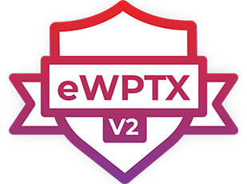

¡Hola!
Vengo a contar mi experiencia de como logré adquirir el certificado de *"eLearnSecurity Web Application Penetration Tester eXtreme"* **(eWPTX)**

He dividido en **6** secciones lo que pude identificar, para cada una de las fases de mi preparación antes, durante y después del **examen**.

Espero le sirva a la persona que está leyendo, así como a mí me sirvieron algunos **reviews** que leí en su momento.

Seré breve en todas las secciones para no saturarlos de información.

**Nota:** Debo indicar que este review es de la versión 2, actualmente está certificación ya se encuentra en la versión 3.

## PRE-REQUISITOS

Realmente aconsejo hacer un plan de estudio, llévalo a tu ritmo, prepárate con calma, disfruta lo que haces, porque estas aprendiendo para tu futuro, no solo para un examen.

* Organiza tu **tiempo** y mantente constante, será de gran ayuda!
* Lleva unos **apuntes**, ya sea en hojas o en un PC (Sublime en mi caso).
* Se proactivo, investiga, lee, mantente **actualizado**.
* Planifica una **meta**, una fecha o una ocasión especial para hacer el examen.
* Si puedes **explicarle** a alguien lo que has aprendido, te ayudara bastante a entender un poco más.

## PREPARACIÓN

Considero que para la eWPTX tienes una cantidad de información de **calidad** a la mano, apóyate en tus colegas, grupos, internet, libros si es necesario, como mejor te sientas para lograr entender lo que estas aprendiendo, no hay un camino correcto, **todos llegamos a un mismo destino**.

En esta ocasión considero que esta certificación presenta técnicas que si presentan un nivel de complejidad avanzado en cuanto a diversidad de ataques web, **no por esto es algo imposible**, es solo que como siempre decimos en este mundo, try harder, entre más claros tengas los conceptos, los ataques y sus ejecuciones, te vas a sentir mejor en el examen, la **metodología** es tu mejor aliada, mantener la calma y tomarte el tiempo necesario hace que fluyan las cosas, disfruta la experiencia, no dejes de lado la documentación, recuerda que en esta ocasión no respondes preguntas, realizas un informe técnico, así que presta mucha atención a los requisitos de ese informe.

Dejaré los temas que son evaluados en la eWPTX:

* XXE.
* SSRF.
* SSTI.
* Java Deserialization.
* SQLi.
* XSS.
* Git Exposure.
* Elaboración de informes. 

## TIPS

El mejor consejo que puedo dar para esta certificación es estar preparado en todos los sentidos, te va a ayudar a concentrarte en el examen, así que te voy a dejar algunas de las cosas que preparé antes de iniciar:

* Recuerda tus `credenciales de la VPN` de INE, un error común antes de iniciar el examen es no recordar esta credencial, esto puede causar que tengas que reiniciar el entorno por renovar las credenciales y volver a descargar la VPN, perdiendo tiempo del examen.
* Ten lo más preparada posible la `plantilla de tu informe`, voy a recomendar el documento que la mayoría utiliza, incluyéndome, la verdad es que la plantilla de [TCM](https://github.com/hmaverickadams/TCM-Security-Sample-Pentest-Report) es bastante completa y funciona excelente, personaliza lo que desees y entiende todo su funcionamiento antes de iniciar el examen, te ayudará mejorar tu tiempo y enfocarte en lo principal.
* Alista tus `notas` con la aplicación de preferencia, es importante que tomes evidencias en cada proceso que ejecutas, yo tenía notas en Sublime y Notion para iniciar a tomar notas del examen, en cuanto a las evidencias tenía un Word dividido por títulos en donde incluía todas las capturas de pantalla.
* Puedo decir que la mayor parte de mi preparación fue con una `serie de videos` del canal de [OmarPalomino](https://www.youtube.com/@OmarPalomino), tiene una playlist de videos inclusive para la ultima versión de la certificación, explicando todos los conceptos mencionados anteriormente, mi proceso de aprendizaje consistia en ver los videos y tomar notas de cada uno de ellos, luego emulaba los laboratorios y continuaba con el siguiente video, hasta completar la playlist.

## EL EXAMEN

Tienes **14** días para realizar el examen (7 laboratorio y 7 informe) y necesitas de una VPN en tu máquina, procura tener buen internet, conectado por cable si es posible, compra algo de comer, algo de tomar, pon música, despliega todas tus notas, duerme bien el día anterior y escoge la mejor hora y fecha para realizar la certificación, si estas tranquilo, todo va a salir bien, no te presiones, tienes bastante tiempo, ten en cuenta que no es un CTF, enfócate en lo que te pide la carta de inicio y no solo en vulnerar todos los sistemas hasta que seas un usuario administrador. 

Recuerda que estás haciendo un pentesting web, enfocate en los servicios que suministran esos puertos, debes consolidar todos los requerimientos que te dan en un informe, recuerda los conceptos de **deserialización**, **XXE** y **SSRF** porque es muy importante tenerlos claros y, por último, sácale el mayor provecho, aprende mucho, **diviértete** y comparte tu conocimiento, ¡alguien más te lo agradecerá!

Ítems claves de la certificación:

* Carta de presentación: Lee con atención todos los requerimientos.
* Duración: 14 días (7 laboratorio y 7 informe).
* Informe final.
* Estudia los ataques web mencionados anteriormente.
* Ten presente tus notas.

## EXTRAS

Te dejare **algunos** links que fueron de ayuda para mí, estoy seguro de que van a ayudarte en este proceso:

* [Canal Youtube Omar Palomino](https://www.youtube.com/@OmarPalomino)
* [Review 1](https://medium.com/@0UN390/ewptx-prepare-resources-a741220cf145)
* [Review 2](https://tun4hunt.medium.com/ewptxv2-exam-review-2023-673aeef6d0c7)
* [Notas y tips](https://github.com/deltacors/ewptx)
* [Conceptos](https://studylib.net/doc/27122711/)
* [Notas de interés](https://github.com/ibrahimalakeel/my-ewptx-notes)
* [Checklist](https://github.com/pessoagabriel/ewptx-topics)
* [Plantilla informe](https://github.com/hmaverickadams/TCM-Security-Sample-Pentest-Report)

## CONCLUSIÓN

Se que ha pasado bastante tiempo (casi un año) o tal vez más, pero quiero contar un poco de lo que viví en su momento y así mismo retomar mi habito de escribirles mis experiencias del hacking, en lo personal esta certificación afianzó mi metodología, el enfocarme en **explotación web** fue todo un desafio, más cuando hay tantos conceptos nuevos en la mesa, sinceramente duré los 7 días revisando las maquinas y 7 días en el **informe**, lo tomé con calma, traté de sacar el máximo provecho de este laboratorio.

Mi metodología se centró en empezar a hacer `reconocimiento` de todo el entorno, esto siempre ayuda no solo en las certificaciones, sino tambien en la vida real como dice un colega mío, en todos los procesos de ethical hacking, el reconocimiento es uno de los pilares del exito.

Con el pasar de las horas, investigando, revisando mis notas y `analizando` las situaciones del entorno, realizo una fase de analisis de codigo estatico y comportamientos anomalos en flujos de desarrollo establecidos, esto me ha ayudado a comprender mejor los servicios, detectar fallas en configuraciones y ampliar mi superficie de ataque.

En la fase de `explotación` es donde empieza lo divertido, múltiples técnicas, vulnerabilidades de todo tipo, básicamente un festín técnico que te lleva al otro nivel, donde muchas veces el poner atencion a los detalles es más efectivo que encontrar la vulnerabilidad misma, es por esa razón que recomiendo descansar, algunos utilizan pomodoro como tecnica de concentración, tu puedes usar el metodo que se acomode a ti, todos somos diferentes, pero llegamos al mismo objetivo que es lo importante.

Recuerda que tienes tiempo, revisa las técnicas que te indiqué anteriormente, mira la playlist recomendada, come bien y duerme, una mente tranquila es una mente enfocada y eficiente!

Las **notas** que tenía previamente fueron bastante útiles, ayudó mucho revisar una por una las vulnerabilidades web y ver ejemplos explicativos, comprender no solo la explotación sino tambien la manera en que se da la vulnerabilidad, en este caso mi punto a mejorar fue la deserialización, tal vez porque no lo he practicado tanto o porque no es mi fuerte el desarrollo en Java ya que fue el que más complejidad tuvo en mi experiencia.

Revisar y dejar a punto la **plantilla del informe** me ahorró muchísimo tiempo en la documentación, prácticamente me dedique a reportar las vulnerabilidades de la manera más completa posible, siento que fue nuevamente un punto positivo muy a favor ir preparado de esta manera.

El examen considero que tiene una gran cantidad de tiempo disponible para poder aprovecharlo al máximo, considero que con los videos del canal de Omar Palomino es más que suficiente, tiene un contenido muy completo, donde tendrás todos los conceptos para lograr pasar. 

Yo recomiendo hacer los laboratorios, estudiar y tomar notas de todo, ponerlo en práctica y si es posible explicarles a tus compañeros para que consolides ese conocimiento adquirido.

Los links de ayuda son una gran oportunidad de tener guías a la mano para no dejar escapar ningún detalle.

Leer la carta de presentación es fundamental, al igual que las preguntas, ahí es donde se debe poner especial atención, debes trabajar para lograr ese resultado. 

Por otro lado y nuevamente, come bien, duerme bien, aléjate del PC de vez en cuando, respira, toma aire, sal a caminar un poco, eso oxigena la mente y te dará un nuevo aire para pensar mejor.

Lo único que puedo decir es que es una excelente certificación para subir un poco el nivel, personalmente me siento muy bien con el trabajo realizado, quería compartir un poco de esta experiencia para que se motiven a hacer la certificación, que aunque sé que tiene una nueva versión, ayuda tanto si estas empezando o si ya eres alguien más experimentado, ¡nunca está de más tener un nuevo reto en la vida!

_¡Que tengan un buen día en el planeta donde se encuentren!_

**Nos vemos en otro bit.**
