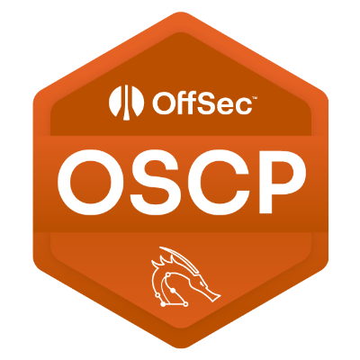

¡Hola!
Vengo a contar mi experiencia de como logré adquirir el certificado de *"Offensive Security Certified Perntester"* **(OSCP)**.

He dividido en **6** secciones lo que pude identificar, para cada una de las fases de mi preparación antes, durante y después del **examen**.

Espero le sirva a la persona que está leyendo, así como a mí me sirvieron algunos **reviews** que leí en su momento.

Seré breve en todas las secciones para no saturarlos de información.

**Nota:** Debo indicar que este review es del 2025, no estoy seguro si hay nuevas actualizaciones a día de hoy.

## PRE-REQUISITOS

Una vez más aconsejo hacer un plan de estudio, llévalo a tu ritmo, prepárate con calma, disfruta lo que haces, porque estas aprendiendo para tu futuro, no solo para un examen.

* Organiza tu **tiempo** y mantente constante, será de gran ayuda!
* Lleva unos **apuntes**, ya sea en hojas o en un PC (Sublime en mi caso).
* Se proactivo, investiga, lee, mantente **actualizado**.
* Planifica una **meta**, una fecha o una ocasión especial para hacer el examen.
* Si puedes **explicarle** a alguien lo que has aprendido, te ayudara bastante a entender un poco más.

## PREPARACIÓN

Considero que para la OSCP tienes una cantidad de información de **calidad** a la mano, apóyate en tus colegas, grupos, internet, libros si es necesario, como mejor te sientas para lograr entender lo que estas aprendiendo, no hay un camino correcto, **todos llegamos a un mismo destino**, yo personalmente he tomado el curso por 1 año, esto fue mejor para lograr estudiar a mi tiempo, quería mantener las cosas con calma y así poder interiorizar los conceptos de una mejor manera.

Esta certificación era mi nivel experto, bajo la relación de tiempo/dificultad, donde se trabaja mucho la metodología, pensar fuera de la caja, web y directorio activo, todo en uno, lo que hace que seas un pentester integral, puedo considerar que es una certificación de complejidad media-avanzada por la agrupación de tantas cosas en un solo momento bajo una supervisión y en tiempo limitado, **no por esto es algo imposible**, es solo que como siempre decimos en este mundo, try harder, entre más claros tengas los conceptos, los ataques y sus ejecuciones, te vas a sentir mejor en el examen, la **metodología** es tu mejor aliada, mantener la calma y tomarte el tiempo necesario hace que fluyan las cosas, disfruta la experiencia, no dejes de lado la documentación, recuerda que en esta ocasión no respondes preguntas, realizas un informe técnico, así que presta mucha atención a los requisitos de ese informe.

Dejaré los temas que son evaluados en la OSCP:

* Metodología.
* Explotación Web.
* Pivoting.
* Active Directory.
* Elaboración de informes. 

## TIPS

El mejor consejo que puedo dar para esta certificación es estar preparado en todos los sentidos, te va a ayudar a concentrarte en el examen, así que te voy a dejar algunas de las cosas que preparé antes de iniciar:

* Alista todo tu `entorno de trabajo`, es muy importante que tengas todas las herramientas a punto, no dejes a la suerte algo que en ese momento no te funcione, prueba todo, has laboratorios, práctica para que vayas lo más preparado posible.
* Ten lo más preparada posible la `plantilla de tu informe`, Offensive Security ofrece su propio template, lo mejor es que vayas con ese mismo, ya está todo listo, a diferencia de los reportes que hacía con INE, este reporte es un poco menos detallado en cuanto a matrices de riesgos, va más al punto, el informe básicamente es explota, saca las evidencias y explica muy bien como lograste obtener las flags, recuerda que tienes 24 horas nada más para ese informe, debes ser lo más eficiente en tu certificación.
* Las `notas` son tus mejores aliadas, recuerda que en esta certificación no puedes utilizar IA, por lo que cuentas netamente con búsquedas en navegadores y tus apuntes, utiliza una aplicación de preferencia, es importante que tomes evidencias en cada proceso que ejecutas, yo tenía notas en Sublime y Notion para iniciar a tomar notas del examen.
* Puedo decir que la mayor parte de mi preparación se dividió en dos, una `serie de videos` del canal de [S4vitar](https://www.youtube.com/@S4viSinFiltro), mirando las máquinas de los gsheets de [LainKusanagi](https://docs.google.com/spreadsheets/d/18weuz_Eeynr6sXFQ87Cd5F0slOj9Z6rt/edit?gid=487240997#gid=487240997) y [NetSecFocus](https://docs.google.com/spreadsheets/u/1/d/1dwSMIAPIam0PuRBkCiDI88pU3yzrqqHkDtBngUHNCw8/htmlview); por otra parte los laboratorios A, B y C de Offensive Security me han parecido fundamentales para entender el flujo de la certificación, tener diferentes escenarios te prepara bastante bien para todas las condiciones y contratiempos que puedes tener en el momento de la certificación, mi proceso de aprendizaje consistía en ver los videos y tomar notas de cada uno de ellos, luego emulaba los laboratorios y continuaba con el siguiente video, hasta completar mi plan de estudio.

## EL EXAMEN

Tienes **2** días para realizar el examen (1 laboratorio y 1 informe) y necesitas de una VPN en tu máquina, procura tener buen internet, conectado por cable si es posible, compra algo de comer, algo de tomar, pon música, despliega todas tus notas, duerme bien el día anterior y escoge la mejor hora y fecha para realizar la certificación, si estas tranquilo, todo va a salir bien, no te presiones, en esta ocasión el tiempo es el que juega en tu contra, uno suele sentir mayor presión por esto, pero desde que tengas buena metodología, puedes sobrepasar esos límites mentales, tienes que identificar las flags de usuario y root, enfócate en lo que te piden y no solo en vulnerar todos los sistemas hasta que seas un usuario administrador. 

Recuerda que estás haciendo un pentesting integral, enfócate en las máquinas stand alone o en el AD, en el que te sientas más fuerte primero, luego lo siguiente, debes consolidar todos los requerimientos que te dan en un informe, recuerda los temas de **AD**, **Enumeración** y **Búsqueda de vulnerabilidades** porque es muy importante tenerlos claros y, por último, sácale el mayor provecho, aprende mucho, **diviértete** y comparte tu conocimiento, ¡alguien más te lo agradecerá!

Ítems claves de la certificación:

* Lee con atención todos los requerimientos.
* Duración: 2 días (1 laboratorio y 1 informe).
* Informe final.
* Estudia los temas mencionados anteriormente.
* Ten presente tus notas.

## EXTRAS

Te dejare **algunos** links que fueron de ayuda para mí, estoy seguro de que van a ayudarte en este proceso:

* [S4vitar machines](https://hackingvault.com/auth/signin)
* [Proving Grounds Writeups](https://medium.com/@ardian.danny)
* [Videos Proving Grounds](https://www.youtube.com/watch?v=9GFtDz9aEfI&list=PLcgWR3INc4O9ujY3YXqzjUdnLS1MT4xWS)
* [Videos Blueprint](https://www.youtube.com/@HackerBlueprint/videos)
* [Videos S4vitar](https://www.youtube.com/@S4viSinFiltro)

## CONCLUSIÓN

Cada vez se me dificulta un poco tener entradas en el blog, pido disculpas por eso, pero quiero contar un poco de lo que viví en su momento, puede ser de ayuda para los próximos pentesters a través de mis experiencias, en lo personal esta certificación afianzó mi metodología, el enfocarme en **enumeración** fue un todo en esta ocasión, mucho más que en certificaciones anteriores, más cuando uno suelen existir tantos caminos diferentes de explotación, el tiempo si influye mucho, llegan momentos en que la preocupación y la frustración se vuelven protagonistas, ahí es donde debes tomar pausas, bebe agua, respira y analiza la situación, porque a veces tienes la respuesta en todo el frente y no te das cuenta.

Mi metodología se centró en empezar a hacer `reconocimiento` de todo el entorno, esto siempre ayuda no solo en las certificaciones, sino también en la vida real como dice un colega mío, en todos los procesos de ethical hacking, el reconocimiento es uno de los pilares del éxito.

Con el pasar de las horas, investigando, revisando mis notas y `analizando` las situaciones del entorno, voy primero con el `directorio activo`, enumerando, revisando todas las vías potenciales de acceso, hasta llegar al punto de acceder a las máquinas víctimas y tomar la administración de ello, luego obtener el administrador y lograr mis primeros 40 puntos si mal no estoy por tener el set de AD, me di cuenta que es muy importante enumerar toda la información posible, no dejar ningún detalle al azar, revisar todas las rutas, las cadenas de caracteres, eso marca bastante la diferencia y te ayuda a ser más eficaz en el momento de analizar información interna, todo esto sucedió las primeras 5 horas, me sentía bien, confiado, era un buen momento para descansar ya que era algo de noche.

Vuelvo luego de una buena noche y empiezo el laboratorio nuevamente, por cada standalone (3 en total), te dan 20 puntos, 10 por ser el usuario y 10 adicionales por ser administrador, mi objetivo era claro, tenía que pwnear `2/3 máquinas standalone` mínimo, para esto antes de la siesta puse a escanear las máquinas faltantes y al ver los resultados en la mañana, empiezo a revisar y encuentro el camino para explotar una máquina de manera exitosa, revisar los archivos es parte importante del poder lograr está máquina, nuevamente la enumeración fue la figura de este laboratorio.

Aquí es donde empieza la preocupación, donde reviso la segunda máquina standalone, luego de muchas horas de enumeración y frustración por no encontrar la manera de lograr acceder a la máquina, tuve que relajarme, analizar bien la situación y revisar cada uno de los detalles que tenía el objetivo, nuevamente prestar atención a los hallazgos de `enumeración` fue la perla en el océano, se logra la explotación y escalamiento de privilegios para fortuna minutos antes de acabar el tiempo, por lo que se logra obtener una totalidad de 80/100 puntos y la obtención de la certificación!

Recuerda revisar las técnicas que te indiqué anteriormente, mira las playlist y gsheets, come bien y duerme, una mente tranquila es una mente enfocada y eficiente! Enumera!

Las **notas** que tenía previamente fueron bastante útiles, ayudó mucho revisar una por una las vulnerabilidades, comprender no solo la explotación sino también la manera en que se da la vulnerabilidad, en este caso mi punto a mejorar fue la enumeración y manejo de la frustración, muchas veces nos quedamos todo el tiempo en el mismo agujero negro sin pensar que hay otras posibilidades.

Revisar y dejar a punto la **plantilla del informe** me ahorró muchísimo tiempo en la `documentación`, pude descansar y prácticamente me dedique a reportar las vulnerabilidades de la manera más completa posible, siento que fue nuevamente un punto positivo muy a favor ir preparado de esta manera.

El examen considero que es justo en balance, tiene tiempo para que desempeñes una `metodología` bien ejecutada, sin embargo, lo que suele suceder a diferencia de entornos laborales es que suele generar más presiones por las limitantes de horario, las emociones debes regularlas de una buena manera, tu mente es el centro de este laboratorio. 

Yo recomiendo hacer los laboratorios, estudiar y tomar notas de todo, ponerlo en práctica y si es posible explicarles a tus compañeros para que consolides ese conocimiento adquirido.

Los links de ayuda son una gran oportunidad de tener guías a la mano para no dejar escapar ningún detalle.

Leer los requerimientos para poder pasar exitosamente, ahí es donde se debe poner especial atención, debes trabajar para lograr ese resultado. 

Por otro lado y nuevamente, come bien, duerme bien, aléjate del PC de vez en cuando, respira, toma aire, sal a caminar un poco, eso oxigena la mente y te dará un nuevo aire para pensar mejor.

Lo único que puedo decir es que es una excelente certificación para subir mucho más el nivel, personalmente me siento muy bien con el trabajo realizado, quería compartir un poco de esta experiencia para que se motiven a hacer la certificación, en el mundo laboral puede ser bastante importante, ¡nunca está de más tener un nuevo reto en la vida!

_¡Que tengan un buen día en el planeta donde se encuentren!_

**Nos vemos en otro bit.**
