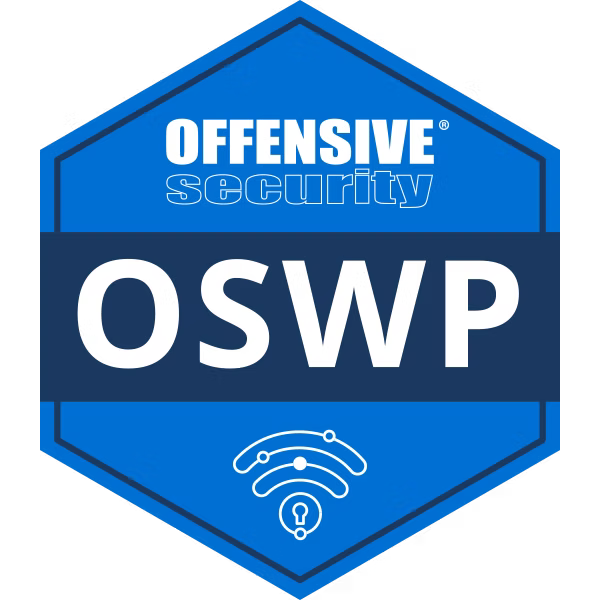

¡Hola!
Vengo a contar mi experiencia de como logré adquirir el certificado de *"Offensive Security Wireless Perntester"* **(OSWP)**.

Como siempre acostumbro, he dividido en **6** secciones lo que pude identificar, para cada una de las fases de mi preparación antes, durante y después del **examen**.

Espero le sirva a la persona que está leyendo, así como a mí me sirvieron algunos **reviews** que leí en su momento.

Seré breve en todas las secciones para no saturarlos de información, mi intención es mostrar que todos podemos lograr nuestros propios objetivos con dedicación!

**Nota:** Debo indicar que este review es del 2025, no estoy seguro si hay nuevas actualizaciones a día de hoy.

## PRE-REQUISITOS

Una vez más aconsejo hacer un plan de estudio, es lo más fundamental, tu propia metodología te lleva a cosas grandes, llévalo a tu ritmo, prepárate con calma, disfruta lo que haces, porque estas aprendiendo para tu futuro, no solo para un examen.

* Organiza tu **tiempo** y mantente constante, será de gran ayuda!
* Lleva unos **apuntes**, ya sea en hojas o en un PC (Sublime en mi caso).
* Se proactivo, investiga, lee, mantente **actualizado**.
* Planifica una **meta**, una fecha o una ocasión especial para hacer el examen.
* Si puedes **explicarle** a alguien lo que has aprendido, te ayudara bastante a entender un poco más.

## PREPARACIÓN

Considero que para la OSWP tienes una cantidad de información de **calidad** a la mano, apóyate en tus colegas, grupos, internet, libros si es necesario, como mejor te sientas para lograr entender lo que estas aprendiendo, no hay un camino correcto, **todos llegamos a un mismo destino**, yo personalmente he tomado el curso por 1 año que venía con la OSCP, por esta razón he realizado las dos certificaciones, esto fue mejor para lograr estudiar a mi tiempo, quería mantener las cosas con calma y así poder interiorizar los conceptos de una mejor manera.

Pero te soy sincero, estuve tiempo full con la OSCP y eso provocó que estudiar para la OSWP fuera un reto en tiempo record, practicamente un mes con mi gran amigo **The Game 008**, donde tuvimos que pasar de largo bastantes días, donde repartir el tiempo para trabajo, familias y estudio con el paso de los años se vuelve cada vez más complicado.

Esta certificación es todo lo que necesitas saber en cuanto a fundamentes para auditar redes **WiFi**, creo que la relación de tiempo/dificultad es adecuada, incluso con contratiempos tienes el tiempo para revisar que sucede con tus codigos, conexiones, etc. Las certificaciones de Offensive en general trabajan mucho la metodología, si sabes como trabajar, conoces tus herramientas y sabes por donde ir bajo tus experiencias te hace un pentester integral, puedo considerar que es una certificación de complejidad media, no es muy común tener experiencia en ejercicios WiFi, por ende las oportunidades de tener experiencias laborales son muy pocas y eso hace que interiorizar este tipo de escenarios sea un poco más complejo de comprender. **No por esto es algo imposible**, es solo que como siempre decimos en este mundo, try harder, entre más claros tengas los conceptos, los ataques y sus ejecuciones, te vas a sentir mejor en el examen, nuevamente la **metodología** es tu mejor aliada, mantener la calma y tomarte el tiempo necesario hace que fluyan las cosas, disfruta la experiencia, no dejes de lado la documentación, recuerda que en esta ocasión no respondes preguntas, realizas un informe técnico, así que presta mucha atención a los requisitos de ese informe.

Dejaré los temas que son evaluados en la OSWP:

* Reconocimiento inalámbrico.
* Ataques WEP/WPA/WPA2.
* Cracking de credenciales.
* Archivos de conexión.
* Análisis de tráfico inalámbrico.
* Elaboración de informes. 

## TIPS

El mejor consejo que puedo dar para esta certificación es estar preparado en todos los sentidos, tal vez lo haya dicho antes, pero es que despues de estas certificaciones, definitivamente te va a ayudar a concentrarte en el examen, así que te voy a dejar algunas de las cosas que preparé antes de iniciar:

* Alista todo tu `entorno de trabajo`, es muy importante que tengas todas las herramientas a punto, no dejes a la suerte algo que en ese momento no te funcione, prueba todo, has laboratorios, práctica para que vayas lo más preparado posible.
* Ten lo más preparada posible la `plantilla de tu informe`, Offensive Security ofrece su propio template, lo mejor es que vayas con ese mismo, ya está todo listo, este reporte es un poco menos detallado en cuanto a matrices de riesgos, va más al punto, el informe básicamente es explota, saca las evidencias y explica muy bien como lograste obtener las flags, recuerda que tienes 4 horas de examen y 24 horas para ese informe, debes ser lo más eficiente en tu certificación.
* Las `notas` son tus mejores aliadas, recuerda que en esta certificación no puedes utilizar IA, por lo que cuentas netamente con búsquedas en navegadores y tus apuntes, utiliza una aplicación de preferencia, es importante que tomes evidencias en cada proceso que ejecutas, yo tenía notas en Notion para iniciar a tomar notas del examen.
* Puedo decir que la mayor parte de mi preparación se ejecutó gracias a la `serie de videos` del canal de [Securiters](https://www.youtube.com/watch?v=kvFBsvBA5ac&list=PLXiewoasm8VlDha0goSG3U_DCQOGlpG21), donde resuelven el famoso [WiFi_Challenge](https://lab.wifichallenge.com/) de R4ulcl, tengo que decir que si resuelves todo este lab, estás con toda la seguridad de poder presentarte a la certificacion, contempla todos los escenarios posibles, tambien te da todas las herramientas y el paso a paso para no solo resolverlo sino entender como funciona este mundo, basicamente lo que haciamos era ver los videos, replicar nuestros entornos y hacer retroalimentación de los aprendizajes, errores, diferentes maneras de hacerlo, etc.

## EL EXAMEN

Tienes **4** horas para realizar el examen (1 laboratorio) y 1 día de informe, necesitas de una VPN en tu máquina, procura tener buen internet, conectado por cable si es posible, compra algo de comer, algo de tomar, pon música, despliega todas tus notas, duerme bien el día anterior y escoge la mejor hora y fecha para realizar la certificación, si estas tranquilo, todo va a salir bien, no te presiones, en esta ocasión el tiempo es el que juega en tu contra, uno suele sentir mayor presión por esto, pero desde que tengas buena metodología, puedes sobrepasar esos límites mentales, tienes que identificar las flags de la red, enfócate en lo que te piden y no solo en vulnerar todos los sistemas hasta que seas un usuario administrador.

Recuerda que estás haciendo un pentesting integral a nivel inalambrico, recuerda que son 3 redes, enfócate en los tipos de redes a las que te enfrentas, en WiFi, saber detectar el tipo de red, técnica, canales, ESSID, BSSID, modos de las interfaces, archivos de configuración, etc. Empieza en el que te sientas más fuerte primero, luego lo siguiente, debes consolidar todos los requerimientos que te dan en un informe y, por último, sácale el mayor provecho, aprende mucho, **diviértete** y comparte tu conocimiento, ¡alguien más te lo agradecerá!

Ítems claves de la certificación:

* Lee con atención todos los requerimientos.
* Duración: 4 horas (+ 1 día de informe).
* Informe final.
* Estudia los temas mencionados anteriormente.
* Ten presente tus notas.

## EXTRAS

Te dejare **algunos** links que fueron de ayuda para mí, estoy seguro de que van a ayudarte en este proceso:

* [WiFi Challenge](https://lab.wifichallenge.com/)
* [Securiters YouTube](https://www.youtube.com/c/Securiters/playlists)

## CONCLUSIÓN

Las entradas en el blog son cada vez más distantes, sin embargo, es importante para mi compartirles el conocimiento adquirido y para ustedes que me siguen desde bastante tiempo, aprecio y agradezco siempre estos espacios porque como **comunidad de ciberseguridad ofensiva** debemos trabajar para mantener e impulsar a nuevas generaciones con contenido facil de entender y lleno de motivación. Quiero contar un poco de lo que viví en su momento, puede ser de ayuda para los próximos pentesters a través de mis experiencias, en lo personal esta certificación afianzó mi metodología en cuanto a WiFi, he tenido el privilegio de poder hacer auditorias inalambricas y el poder entenderlo de mejor manera, más estructurado, elevó mi nivel en este tipo de auditorias, ahora hay un panorama 360 de todo lo que encuentras, tecnologias, entre otros, ya no es un simple escaneo y obtener un handshake que tal vez no logres crackear porque resulta que la contraseña si resulta segura o absurda. Aquí vas un poco más a tiro hecho, por eso es menos tiempo, siempre es la misma estructura, ataques para ciertas redes y metodos de ejecución, no tienes tantas variantes que es lo que suele agobiar como en otras certificaciones, me pasa en particular con las web, porque la cantidad de ataques y vectores es excesiva, entonces tienes que pensar y enumerar mucho más para lograr el objetivo, llegan momentos en que la preocupación y la frustración se vuelven protagonistas, ahí es donde debes tomar pausas, bebe agua, respira y analiza la situación, porque a veces tienes la respuesta en todo el frente y no te das cuenta.

Mi metodología se centró en empezar a hacer `reconocimiento` de todo el entorno, esto siempre ayuda no solo en las certificaciones, sino también en la vida real como dice un colega mío, en todos los procesos de ethical hacking, el reconocimiento es uno de los pilares del éxito.

Encuentro mi primera red y aplico los conceptos de ataque de esa red, debes entender a que tipo de red te enfrentas para que conceptualmente sepas cual es el ataque que mejor le queda a esa red y con la cual vas a tener exito de **explotación**, esto es muy importante porque si lo tienes claro, vas a avanzar muy rapido. Los archivos de configuración son importantes, entender que hace cada linea te ayuda a tener una conexión exitosa, de lo contrario por más que tengas las keys, no vas a poder conectarte.

Voy por la segunda red que identifico rapidamente, saber moverse entre modo monitor y managed es fundamental, entender los **tipos de ataques** contra los agentes conectados acelera el proceso de obtener información útil para la certificacion. Siempre asegurate de tener las capturas de información completas, no solo esperes obtener un handshake, recuerda los conceptos de red inalambrica porque te van a salvar la vida si los tienes presentes, la clave es la velocidad, pero tambien es entener que nos funciona y que no para esos momentos.

Y aquí me encontraba con mi tercera y última red, en realidad me quedaba muy poco tiempo y la presión se hacia notar definitivamente, **empieza la preocupación**, debes mantener la calma porque puedes crashear el laboratorio, tus interfaces estan conectadas a otras redes, tu interfaz está en el modo que no deberia, el archivo de configuración no está configurado correctamente, todo estos detalles pueden jugar en tu contra, por ende todo depende completamente de ti, no solo de lo que sabes sino de tus capacidades blandas, de tu paciencia y conocimiento.

Recuerda obtener las flags apenas entras a la red, sin ellas es como si no lograras crackear la red, es un requisito indispensable para la certificación.

Las **notas** que tenía previamente fueron bastante útiles, ayudó mucho revisar una por una las vulnerabilidades, comprender no solo la explotación sino también la manera en que se da la vulnerabilidad, en este caso mi punto a mejorar fue la enumeración y manejo de la frustración, muchas veces nos quedamos todo el tiempo en el mismo agujero negro sin pensar que hay otras posibilidades.

Revisar y dejar a punto la **plantilla del informe** me ahorró muchísimo tiempo en la `documentación`, pude descansar y prácticamente me dedique a reportar las vulnerabilidades de la manera más completa posible, siento que fue nuevamente un punto positivo muy a favor ir preparado de esta manera.

El examen considero que es justo en balance, tiene tiempo para que desempeñes una `metodología` bien ejecutada, sin embargo, lo que suele suceder a diferencia de entornos laborales es que suele generar más presiones por las limitantes de horario, las emociones debes regularlas de una buena manera, tu mente es el centro de este laboratorio. 

Yo recomiendo que revises los links que de dí en este post, ponerlo en práctica y si es posible explicarles a tus compañeros para que consolides ese conocimiento adquirido.

Leer los requerimientos para poder pasar exitosamente, ahí es donde se debe poner especial atención, debes trabajar para lograr ese resultado. 

Por otro lado y nuevamente, come bien, duerme bien, aléjate del PC de vez en cuando, respira, toma aire, sal a caminar un poco, eso oxigena la mente y te dará un nuevo aire para pensar mejor.

Lo único que puedo decir es que es una excelente certificación para subir mucho más el nivel, personalmente me siento muy bien con el trabajo realizado, quería compartir un poco de esta experiencia para que se motiven a hacer la certificación, en el mundo laboral puede ser bastante importante, ¡nunca está de más tener un nuevo reto en la vida!

_¡Que tengan un buen día en el planeta donde se encuentren!_

**Nos vemos en otro bit.**
